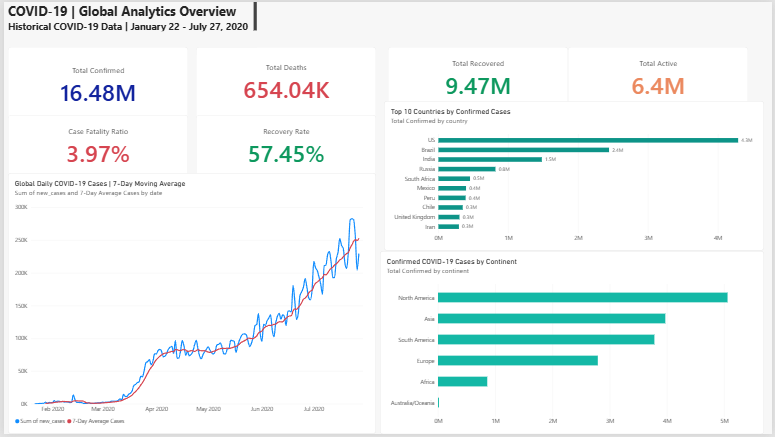
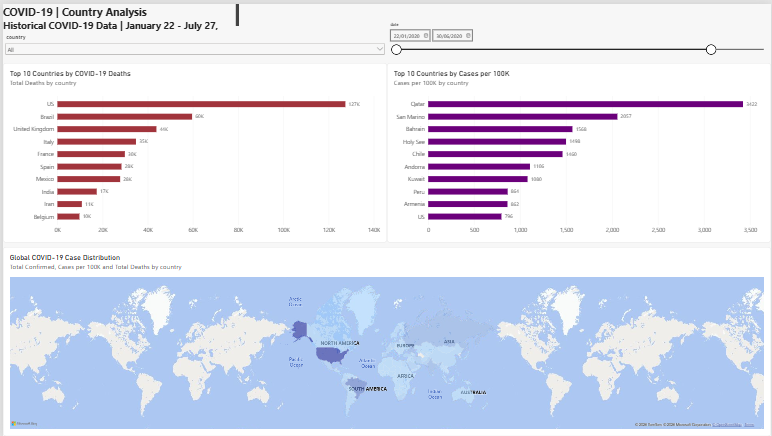

# COVID-19 Global Analytics Dashboard

*Python | Pandas | Power BI | DAX | Data Visualization

## Project Overview

An end-to-end data analytics project exploring global COVID-19 trends from **January 22 to July 27, 2020**.

The project uses Python for data cleaning, integration, and exploratory data analysis (EDA), followed by Power BI to develop a two-page interactive report featuring key performance indicators, historical trends, geographic comparisons, and population-adjusted statistics.

**Objective:** Transform raw public-health data into an interactive analytical report that allows users to explore COVID-19 trends across countries and continents.

## Technologies Used

- **Python:** Data preparation and analysis
- **Pandas and NumPy:** Cleaning, transformation, aggregation, and calculations
- **Matplotlib and Seaborn:** Exploratory data visualization
- **Power BI Desktop:** Interactive report development
- **DAX:** Dynamic measures, ratios, and moving averages
- **Jupyter Notebook:** Reproducible data cleaning and exploratory analysis

## Dataset

The project combines historical COVID-19 reporting data with country-level population and regional information.

The processed dataset contains:

- 35,156 country-date observations
- 187 countries/regions
- 188 reporting dates
- 12 columns covering cases, deaths, recoveries, geographic information, and population

**Reporting period:** January 22 – July 27, 2020

## Data Sources

The historical COVID-19 datasets used in this project were downloaded from:

- **Kaggle:** [COVID-19 Dataset — imdevskp](https://www.kaggle.com/datasets/imdevskp/corona-virus-report)
- **Original reporting source:** [Johns Hopkins University CSSE COVID-19 Data Repository](https://github.com/CSSEGISandData/COVID-19)
- **Additional reporting source:** [Worldometer](https://www.worldometers.info/coronavirus/)

The dataset contains historical country-level COVID-19 statistics, including confirmed cases, deaths, recoveries, and geographic information. The analysis covers January 22 through July 27, 2020.

The original datasets were cleaned, standardized, and integrated using Python and Pandas before being used in Power BI.

## Data Cleaning and Preparation

Using Pandas, the project includes:

- Standardizing column names and country identifiers
- Converting date fields into datetime format
- Examining missing values and duplicate records
- Identifying and investigating inconsistent values
- Integrating country population and continent data
- Exporting the cleaned dataset for Power BI

The cleaned dataset is saved as `data/processed/covid_cleaned.csv`.

## Exploratory Data Analysis

The Python analysis explores:

- Global confirmed cases, deaths, recoveries, and active cases
- Case fatality and recovery ratios
- Top 10 countries by confirmed cases and deaths
- Daily reported cases and seven-day moving averages
- COVID-19 cases across continents
- Confirmed cases and deaths per 100,000 people

## Power BI Dashboard

The Power BI report contains two interactive pages.

### Page 1 — Global Overview

Features:

- Six KPI cards displaying global COVID-19 statistics
- Daily new cases and seven-day moving average
- Top 10 countries by confirmed cases
- Confirmed cases by continent
- Interactive chart selections



### Page 2 — Country Analysis

Features:

- Top 10 countries by reported deaths
- Top 10 countries by confirmed cases per 100,000 people
- Interactive country and date slicers
- Geographic distribution of confirmed cases
- Country-level tooltips displaying confirmed cases, deaths, and population-adjusted case counts



## Key Findings

The following findings are based on historical data through July 27, 2020.

- **16.48 million** confirmed COVID-19 cases were reported globally.
- The 10 countries with the most confirmed cases accounted for **68.02%** of global confirmed cases.
- The 10 countries with the most reported deaths accounted for **74.46%** of global deaths.
- North America had the highest number of reported confirmed cases among the continents in this dataset.
- Qatar had approximately **3,903 confirmed cases per 100,000 people**, the highest population-adjusted case count among countries with available population data.
- Daily reported cases increased substantially between March and July 2020, with the seven-day moving average revealing the sustained upward trend.

## Project Structure

```text
COVID-19 Dashboard/
├── dashboard/
│   └── COVID-19_Global_Analytics.pbix
├── data/
│   ├── raw/
│   └── processed/
│       └── covid_cleaned.csv
├── notebooks/
│   ├── 01_data_cleaning.ipynb
│   └── 02_exploratory_analysis.ipynb
├── screenshots/
│   ├── global_overview.png
│   └── country_analysis.png
├── requirements.txt
├── .gitignore
└── README.md
```

## How to Run

1. Clone or download this repository.
2. Install the required Python libraries:

   ```bash
   pip install -r requirements.txt
   ```

3. Open `notebooks/01_data_cleaning.ipynb` in VS Code or Jupyter Notebook and run all cells.
4. Open `notebooks/02_exploratory_analysis.ipynb` and run all cells.
5. Open `dashboard/COVID-19_Global_Analytics.pbix` using Power BI Desktop.

**Note:** The notebooks expect the project's existing folder structure. The Power BI report may require updating the CSV source path to data/processed/covid_cleaned.csv when opened on another computer.

The Power BI report may require updating its local CSV source path when opened on another computer.

## Limitations

- The analysis covers a historical period ending July 27, 2020, and should not be interpreted as current COVID-19 statistics.
- Country-level reporting and testing practices differed during the pandemic.
- Population information was unavailable for some country identifiers, including China and Kosovo, in the integrated dataset. Population-adjusted calculations therefore require valid population values.
- Some country-level records contain missing or inconsistent active-case values, which may affect certain comparisons.
- The legacy Filled Map visual displays a retirement warning, and geographic visualization functionality may depend on Power BI organizational settings.
- Case fatality ratios describe reported deaths relative to confirmed cases and should not be interpreted as infection fatality rates.

## Project Purpose

This project demonstrates an end-to-end data analytics workflow: preparing and validating raw data, performing exploratory analysis, defining meaningful metrics, building interactive visualizations, and communicating findings through a business-intelligence report.
